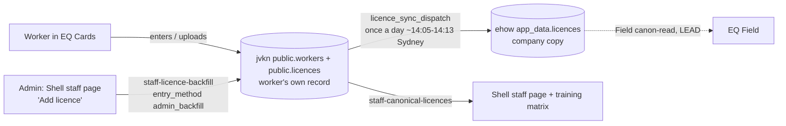

# DRAFT — Is reconciling worker records Intake's job?

Status: DRAFT for Royce. Docs only. No code, SQL or schema. Written 2026-11-19.
Scope: EQ platform, SKS as the tenant under study. No client names.

## Tag key

- **verified (how, date)** — checked directly, with the method named.
- **brief** — checked live by Royce's brief on 2026-11-19 (read-only SQL, GitHub connector, git/ls). **Not re-run in this session.** Carried in as given.
- **LEAD** — believed, not proven.

## Short answer

Yes, comparing files against worker records fits Intake (AI proposes, human confirms, decisions cached, audit and rollback). But one assumption under it is wrong: **the training matrix does not read the company copy.** It reads the worker's own record (jvkn). So "compare against the company copy" aims at a copy the matrix does not use. Recommendation: option A, but decide what it compares against (Q3) before building anything.

## 1. How worker records move

Plain English:

1. A licence enters jvkn two ways: the worker adds it in Cards, or an admin adds it for them through Shell "Add licence".
2. Admin-added rows are saved under the **worker's** name as actor in the main audit log. The admin shows only in the metadata (`entered_by`, `entered_by_name`, `entry_method`) and in a separate Shell audit event `cards.licence_backfill.added`.
3. A daily job copies jvkn rows to the company copy on ehow. It is not instant.
4. The Shell staff page and training matrix read jvkn, not the company copy.

| Claim | Tag |
|---|---|
| jvkn `public.workers` / `public.licences` hold the worker's own record; licence metadata carries `entered_by`, `entered_by_name`, `entered_at`, `entry_method` | brief |
| 2026-11-19: 25 rows with `entry_method = admin_backfill`, one admin, 14 minutes; `ocr_usage` had 0 calls that day | brief |
| `public.audit_log` credits the worker as actor; `shell_control.audit_log` has `cards.licence_backfill.added` with the admin as actor | brief |
| `licence_sync_dispatch` runs once a day 14:05–14:13 Sydney (~100 dispatches/day, last 8 days). Of the 25 new rows, 10 had reached ehow `app_data.licences` and 15 had not, across six workers | brief |
| Shell staff page reads licences from `public.licences` (jvkn) via `staff-canonical-licences`; its header comment says the old read of `app_data.licences` returned empty and "Canonical is the single source of truth" | verified (read eq-shell `origin/main` d589a5c1, file `netlify/functions/staff-canonical-licences.ts`, and `src/pages/StaffPage.tsx` around line 376, 2026-11-19) |
| The matrix component (`MatrixView`) is fed by that same page's `licByStaff` | verified (code read, same commits; component receives `licByStaff` from StaffPage) |
| Shell "Add licence" (`AddLicenceModal` → `staff-licence-backfill.ts`) writes `entry_method` `admin_backfill` / `admin_backfill_update` | verified (code read, eq-shell `origin/main` d589a5c1, 2026-11-19) |
| Shell "Add Licence" and the 2026-11-19 `admin_backfill` rows came from the same screen | LEAD — code path matches, but I did not link the 25 live rows to a screen |
| eq-field has its own matrix-style compliance views reading through `canon-read` | LEAD — saw comments only (eq-field `origin/main` 1ec407cb); did not trace what `canon-read` reads for SKS |
| Which "SKS training matrix" Royce means (Shell's, or Field's) | LEAD — open, Q1 |
| `ops/decisions.md` 2026-05-19 "Dedupe Is Intake's Job"; 2026-10-08 worker maintains own details, company records acceptance never a gate; 2026-11-17 option C "admin proposes, worker accepts in Cards", parked | brief (eq-context fd6c88c, via GitHub connector) |
| `schemas/` has `staff.schema.json` and no licence schema | verified (`ls` and grep of `schemas/` in this worktree, 2026-11-19; only `asset_test_result` and `swms` mention "licen" in passing) |
| Recent Intake commits: timesheet reconcile prototype and write-plan builder (#189); mapping memory and undo-plan builder (#194) | brief |
| eq-cards migration `0286_licence_holder_acceptance.sql` exists on eq-cards `origin/main` ad21e41 | verified (`git ls-tree`, 2026-11-19). Whether it is applied: LEAD, not checked |

## 2. Options

Carried in and not reopened: A is the shape, B is rejected for now, C is not a standing answer.

**A. Intake proposes, never commits to the worker's record.**
Intake compares files (spreadsheets, scans, email lists) against existing records, proposes rows into a queue, a human confirms. The commit happens through the existing route (Shell "Add licence" now; worker accept in Cards once 0286 lands).
- Fits: the Dedupe decision, the 2026-10-08 rule, the Rule 1/Rule 2 limits in CLAUDE.md (no DDL, no ledger writes, schema belongs to the owning repo).
- Cost: needs somewhere to hold proposals (Q4) and a decision on what to compare against (Q3).

**B. Intake commits to the worker's record. Rejected for now.**
Rejected 2026-11-18: it skips the worker's accept step, and jvkn is not an Intake plane. (brief)

**C. Do it by hand. Not a standing answer.**
Today's reality: an admin keyed 25 rows in 14 minutes. It works, but nothing catches duplicates or typos, and 15 of 25 were not in the company copy the same day.

**Recommendation: A**, built in this order:
1. Answer Q1–Q4 below.
2. Read-only comparison first (no queue), run by a person, to see how many mismatches a real file produces.
3. Only then a proposal queue, owned by the repo Royce names in Q4.

## 3. Questions for Royce

1. **What feeds "the matrix"?** Shell's training matrix reads jvkn (verified). Is that the one you mean, or Field's view? If Field's, the answer may differ (LEAD).
2. **Is Shell "Add licence" the same screen as the `admin_backfill` rows?** Code says yes. Confirm with the admin who did the 25 rows.
3. **Reconcile against jvkn as well as the company copy?** The matrix and the worker's accept step both live on jvkn; the company copy lags by up to a day. Recommend: compare against jvkn read-only for "what the worker has", and against the company copy only for "has it synced". jvkn is not an Intake plane, so this needs your OK and a read-only route.
4. **Who owns the proposal queue?** `app_data.eq_remediation_queue` already exists on ehow (service-role only; documented in this repo's CLAUDE.md, which I read today) but it is the company copy plane. A queue for jvkn-targeted proposals is a schema change for eq-shell or eq-cards, not Intake (Rule 2).

## 4. What would change the recommendation

- Moves toward B: 0286 is applied and the worker accept step is real and in use, *and* you decide a worker accepting a proposal in Cards counts as the commit. Then Intake could hand proposals to that accept step, which is still not a direct write.
- Moves toward C (standing): volumes stay at a few dozen rows a month and mismatches stay near zero after a read-only trial.
- Moves away from A as written: the matrix turns out to read the company copy after all (Q1), or you want the company copy to be the source (a reversal of the "canonical is the single source" comment).
- Pauses everything: the daily sync gap (15 of 25 missing) turns out to be a bug rather than a schedule, because any comparison would then report noise.

## 5. Found in passing (not acted on)

- The daily sync leaves rows missing for up to a day. Anyone reading the company copy right after a bulk entry sees a partial picture. (brief)
- Admin-entered rows show the worker as actor in the main audit log. Anyone using that log to answer "who entered this" gets the wrong person; the right answer is in the metadata or the Shell audit event. (brief)
- `staff-canonical-licences.ts` says `app_data.licences` on Field "is now empty", yet the live sync writes rows to ehow `app_data.licences` (brief). One of the two is out of date. LEAD.
- Local clones in `C:\Projects` were far behind (eq-shell 1163 commits). The `eq-context` clone is also behind. Anything read from local clones rather than `origin/main` may be stale.
- This session's branch is `claude/worker-records-role-draft-1fc0a8` (suffix added by the tool), not the exact name in the brief.

## 6. Not checked

- No database was queried this session. Every "brief" row above is Royce's brief carried in unverified here.
- Whether 0286 is applied on any plane.
- What Field's `canon-read` reads for SKS, and what Field renders for its own matrix.
- Whether `entity-patch` or any other job writes to `app_data.licences` besides the daily sync.
- The decisions file itself (not re-read; carried from the brief).
- Whether the sync gap is a schedule effect or a failure.
- Anything on the SKS live plane (ehow). Not touched.
