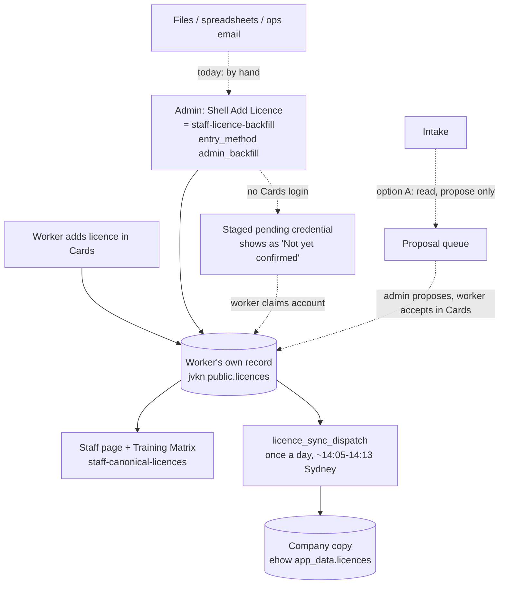

# Worker record reconciliation: what is Intake's role? (DRAFT)

Status: DRAFT for Royce. Docs only. Nothing here changes code, schema or sync.
Written 2026-11-19. Tenant under study: SKS (on the EQ platform).

## How to read the tags

- **verified (code)**: read in `eq-shell` `origin/main` by `git show` / `git grep`, 2026-11-19. Read-only. No database touched.
- **verified (local)**: read in this checkout (`eq-intake` `origin/main`), 2026-11-19.
- **carried in**: stated as verified live in Royce's brief (SQL via Supabase MCP, or GitHub connector, 2026-11-19). **Not re-run in this drafting session.** Treat as true but second-hand.
- **LEAD**: not checked. Do not rely on it.

## Short version

The training matrix and Staff page read the **worker's own record** (`public.licences` on the shared control layer, jvkn). They do not read the company copy. So the 15 admin-entered rows that never reached the company copy are already on the matrix. Intake's job, if it takes one, is to compare files against the worker's own record, read-only, and propose rows. It should not write to that record.

## 1. Map: how worker records move

| Claim | Tag |
|---|---|
| The Staff page and Training Matrix get licences from `staff-canonical-licences`, which reads `public.licences` (eq-canonical) for connected, linked workers. | verified (code), eq-shell `netlify/functions/staff-canonical-licences.ts` and `src/pages/StaffPage.tsx` ~line 376 |
| That function's header calls canonical "the single source of truth" and says the old read of `app_data.licences` "is now empty". | verified (code). The comment is undated. It conflicts with the carried-in sync numbers below, so one of the two is stale. |
| The matrix Excel export reads no licence data itself. It dresses up what the browser already holds. | verified (code), `training-matrix-export-xlsx.ts` header |
| Shell "Add Licence" (`AddLicenceModal.tsx`) posts to `staff-licence-backfill`, which stamps `entry_method admin_backfill`. So Add Licence and admin_backfill are the same path. | verified (code). Whether there is a second screen that also posts there (the bulk `ImportCertificatesModal.tsx` also calls it) is noted, not tested in a browser. |
| A worker with no Cards login gets a staged pending credential, not a licence row. It becomes a licence row when they claim an account. | verified (code), `staff-licence-backfill.ts` header |
| jvkn `public.workers` and `public.licences` hold the worker's own record. Licence rows carry `entered_by`, `entered_by_name`, `entered_at`, `entry_method`. On 2026-11-19, 25 rows are `admin_backfill` from one admin over 14 minutes. `ocr_usage` had 0 calls that day. | carried in |
| `public.audit_log` credits the worker as actor on those rows. `shell_control.audit_log` has `cards.licence_backfill.added` with the admin as actor. | carried in |
| `licence_sync_dispatch` runs once a day, 14:05 to 14:13 Sydney (about 100 dispatches a day, last 8 days). On 2026-11-19, 10 of the 25 new rows had reached ehow `app_data.licences` and 15 had not, across six workers. | carried in |

Plain reading: an admin entering a licence for a worker lands in the worker's own record straight away. The audit trail on the worker's side names the worker, not the admin. The company copy follows once a day, and not always.

## 2. Options

**A. Intake compares and proposes. It never commits to the worker's own record.** (carried-in decision, not reopened)
- Intake reads a file, compares it with what is already held, and writes proposed rows to a queue. A human confirms. Fits the 2026-05-19 "Dedupe Is Intake's Job" rule and the 2026-10-08 rule that the worker maintains their own details.
- Change from the brief: compare against the **worker's own record**, because that is what the matrix shows. Comparing only against the company copy would flag rows that are already on the matrix and miss ones that are wrong on it.

**B. Intake commits to the worker's own record.** Rejected for now (carried in: rejected 2026-11-18). It skips the worker's accept step, and jvkn is not an Intake plane. This doc adds one point: `eq-intake` `CLAUDE.md` Rule 1 allows data-only writes on tenant planes (ehow, zaap) but says nothing that lets Intake write to jvkn (verified local). That reinforces the rejection.

**C. Do it by hand.** The state today (admin types or imports each licence). Not a standing answer (carried in).

**Recommendation: A, with the compare target set to the worker's own record, read-only.** If Royce wants the company copy checked as well, treat that as a second, separate report, because the sync gap is a different problem from "is the file right".

## 3. Open questions for Royce

Answers added 2026-11-19 after Royce asked for them. Items 1 and 2 are settled by code. Items 3 and 4 are recommendations; the decision is Royce's.

1. **What feeds the matrix?** SETTLED: the worker's own record (verified (code)). Still open: the old comment says the company copy is empty, yet the sync still sends rows into it (carried in). One of the two is stale. Settling it needs a live read, which needs Royce's yes (LEAD).
2. **Shell Add Licence vs admin_backfill?** SETTLED: same path (verified (code)). The bulk Import Certificates screen also posts to it.
3. **Reconcile against the worker's own record as well as the company copy?** RECOMMENDED: yes, own record first.
   - The matrix shows the worker's own record, so wrong or missing rows there are what users see.
   - The company copy is a second, separate report: is the daily copy keeping up?
   - Intake needs a read-only feed of the worker's own record, asked for from eq-shell. Intake does not get its own connection to jvkn. The shape of that feed is a LEAD, not designed.
4. **Who owns the proposal queue?** RECOMMENDED: Intake writes proposals to the existing `app_data.eq_remediation_queue` on the tenant plane. Shell owns the admin review screen.
   - No new schema. Data-only writes are allowed under Rule 1 (verified (local)).
   - Gap: that queue is on the tenant plane, but the worker's accept step lives in Cards on the worker's own record. Joining them is the parked "admin proposes, worker accepts" idea (carried in; migration 0286 drafted, not applied, LEAD). Until then a confirmed proposal is entered by hand through Add Licence.
   - Any new table or screen belongs to the owning repo, not Intake (Rule 2).

## 4. What would change the recommendation

- **Toward B:** the worker's accept step in Cards ships and is applied (LEAD: licence accept migration 0286 in eq-cards is drafted, not applied), and Royce decides a company-run commit through that step is acceptable.
- **Toward A against the company copy only:** the matrix is moved onto the company copy, or the sync becomes reliable and the company copy becomes what the matrix reads.
- **Toward C staying:** the volume stays at tens of rows a day from a few admins, and no one has time to review a queue.
- **Against any Intake role:** a read-only route to the worker's own record cannot be built without making jvkn an Intake plane.

## 5. Found in passing

- eq-shell holds a vendored licence schema: `eq-intake/eq-platform/packages/eq-schemas/src/schemas/licence.schema.json`. eq-intake's own `schemas/` has staff and others but no licence schema (verified (local), verified (code)). Two homes for one thing is the drift Rule 2 warns about. Not acted on.
- The "is now empty" comment in `staff-canonical-licences.ts` is undated and conflicts with the carried-in sync numbers. Needs a live check by someone with approval.
- Today's 25 admin-entered rows show the worker as actor in `public.audit_log` (carried in). That makes the worker's side of the trail wrong about who entered them.
- The eq-shell `staff-licence-backfill` header says a back photo is not promoted for unclaimed workers (verified (code), "known gap" in the header).

## 6. Not checked

- No database connection of any kind was made. Every row count, timing and audit claim above is carried in.
- `ops/decisions.md` in eq-context was not re-read. The connector could not resolve the commit `fd6c88c`, and the local clone is 500+ commits behind. Decision wording and dates are carried in.
- Not re-verified: licence accept migration 0286 (LEAD), the age of the "is now empty" comment, whether anything else still reads the company copy, and which exact plane the matrix's database client points at beyond what the code says.
- No browser check of the Shell screens.
- No check of eq-field or eq-cards code.
