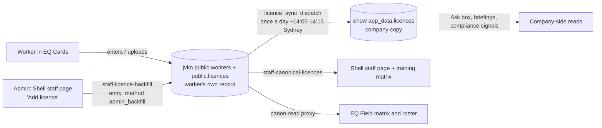

# DRAFT — Is reconciling worker records Intake's job?

Status: DRAFT for Royce. Docs only. No code, SQL or schema. Written 2026-11-19. Updated 2026-11-19 after Royce's answers (Q1, Q3, Q4) and read-only checks on jvkn (counts only, no names or numbers).
Scope: EQ platform, SKS as the tenant under study. No client names.

## Tag key

- **verified (how, date)** — checked directly, with the method named.
- **brief** — checked live by Royce's brief on 2026-11-19 (read-only SQL, GitHub connector, git/ls). **Not re-run in this session.** Carried in as given.
- **LEAD** — believed, not proven.

## Short answer

Yes, comparing files against worker records fits Intake (AI proposes, human confirms, decisions cached, audit and rollback). But one assumption under it is wrong: **the training matrix does not read the company copy.** It reads the worker's own record (jvkn). So "compare against the company copy" aims at a copy the matrix does not use. Royce has decided: Q1 is Shell's matrix, and Intake compares against jvkn, read-only (Q3). Recommendation: option A, report only for now (no queue, Q4).

## 1. How worker records move

Plain English:

1. A licence enters jvkn two ways: the worker adds it in Cards, or an admin adds it for them through Shell "Add licence".
2. Admin-added rows are saved under the **worker's** name as actor in the main audit log. The admin shows only in the metadata (`entered_by`, `entered_by_name`, `entry_method`) and in a separate Shell audit event `cards.licence_backfill.added`.
3. A daily job copies jvkn rows to the company copy on ehow. It is not instant.
4. The Shell staff page and training matrix read jvkn, not the company copy. So does EQ Field. Only the Ask box, daily briefing and compliance signals read the company copy.

| Claim | Tag |
|---|---|
| jvkn `public.workers` / `public.licences` hold the worker's own record; licence metadata carries `entered_by`, `entered_by_name`, `entered_at`, `entry_method` | brief |
| 2026-11-19: 25 rows with `entry_method = admin_backfill`, one admin, 14 minutes; `ocr_usage` had 0 calls that day | brief |
| `public.audit_log` credits the worker as actor; `shell_control.audit_log` has `cards.licence_backfill.added` with the admin as actor | brief |
| `licence_sync_dispatch` runs once a day 14:05–14:13 Sydney (~100 dispatches/day, last 8 days). Of the 25 new rows, 10 had reached ehow `app_data.licences` and 15 had not, across six workers | brief |
| Shell staff page reads licences from `public.licences` (jvkn) via `staff-canonical-licences`; its header comment says the old read of `app_data.licences` returned empty and "Canonical is the single source of truth" | verified (read eq-shell `origin/main` d589a5c1, file `netlify/functions/staff-canonical-licences.ts`, and `src/pages/StaffPage.tsx` around line 376, 2026-11-19) |
| The matrix component (`MatrixView`) is fed by that same page's `licByStaff` | verified (code read, same commits; component receives `licByStaff` from StaffPage) |
| Shell "Add licence" (`AddLicenceModal` → `staff-licence-backfill.ts`) writes `entry_method` `admin_backfill` / `admin_backfill_update` | verified (code read, eq-shell `origin/main` d589a5c1, 2026-11-19) |
| Shell "Add licence" and the 2026-11-19 `admin_backfill` rows are the same route: 25 `admin_backfill` licence rows (13:59-14:14 Sydney, one admin) match 25 `cards.licence_backfill.added` audit events (same minutes, one actor); both are written by `staff-licence-backfill` | verified (read-only counts on jvkn `jvknxcmbtrfnxfrwfimn`, `public.licences` and `shell_control.audit_log`, plus code read of eq-shell `origin/main`, 2026-11-19). The screen itself was not watched. |
| EQ Field's licence reads go through `canon-read`, a server proxy to jvkn | verified (code read, eq-field `origin/main` 1ec407cb, file header, 2026-11-19) |
| "The matrix" Royce means is Shell's | decided by Royce, 2026-11-19 (Q1) |
| The company copy (`app_data.licences`) is filled by Shell's sync code: an upsert keyed on the credential id, sent when a licence changes, after a worker connects, and by a nightly reconcile. No other eq-shell code path writes `app_data.licences` | verified for eq-shell `origin/main` d589a5c1 only (code grep and header of `cards-sync-worker-with-licences.ts`, 2026-11-19). Other repos and database jobs not searched. |
| Daily sync dispatches ran 14:05-14:13 Sydney on each of the last 4 days (100-101 a day); 0 had a non-2xx status, a timeout or an error message. One reconcile-log row per day with 100-101 workers | verified (read-only counts, jvkn `licence_sync_dispatch` and `licence_sync_reconcile_log`, 2026-11-19) |
| The 25 rows were entered 13:59-14:14 Sydney, the same window as the daily dispatch | verified (same queries). The 15 rows missing from the company copy fit that timing, but this does not prove it. |
| `ops/decisions.md` 2026-05-19 "Dedupe Is Intake's Job"; 2026-10-08 worker maintains own details, company records acceptance never a gate; 2026-11-17 option C "admin proposes, worker accepts in Cards", parked | brief (eq-context fd6c88c, via GitHub connector) |
| `schemas/` has `staff.schema.json` and no licence schema | verified (`ls` and grep of `schemas/` in this worktree, 2026-11-19; only `asset_test_result` and `swms` mention "licen" in passing) |
| Recent Intake commits: timesheet reconcile prototype and write-plan builder (#189); mapping memory and undo-plan builder (#194) | brief |
| eq-cards migration `0286_licence_holder_acceptance.sql` exists on eq-cards `origin/main` ad21e41. Its header says "DRAFT, NOT APPLIED" and says option C was chosen on 2026-11-18: an admin-entered licence for a worker with a login is saved on jvkn straight away, flagged until the holder accepts, never blocked | verified (file read, 2026-11-19) |
| jvkn `public.licences` already has the column `holder_review_state`, which 0286 adds. So 0286 (or part of it) looks applied despite the header | verified (read-only column lookup on jvkn, 2026-11-19). Which parts are applied and when: not checked. |

## 2. Options

Carried in and not reopened: A is the shape, B is rejected for now, C is not a standing answer.

**A. Intake proposes, never commits to the worker's record.**
Intake compares files (spreadsheets, scans, email lists) against existing records, proposes rows into a queue, a human confirms. The commit happens through the existing route (Shell "Add licence" now; worker accept in Cards once 0286 lands).
- Where it sits against 0286: 0286 flags a row *after* the admin saves it. Intake's report comes *before*: it finds mismatches and duplicates in a file so the admin enters fewer wrong rows. The two do not overlap.
- Fits: the Dedupe decision, the 2026-10-08 rule, the Rule 1/Rule 2 limits in CLAUDE.md (no DDL, no ledger writes, schema belongs to the owning repo).
- Compares against jvkn, read-only (Q3, decided). Needs a read-only route into jvkn for Intake, which is not an Intake plane today.
- Output for now: a printed report. No queue (Q4, decided).

**B. Intake commits to the worker's record. Rejected for now.**
Rejected 2026-11-18: it skips the worker's accept step, and jvkn is not an Intake plane. (brief)

**C. Do it by hand. Not a standing answer.**
Today's reality: an admin keyed 25 rows in 14 minutes. It works, but nothing catches duplicates or typos, and 15 of 25 were not in the company copy the same day.

**Recommendation: A**, built in this order:
1. Read-only comparison first against jvkn, run by a person, printing a report. No queue. See how many mismatches a real file produces.
2. Only if the volume justifies it, revisit a proposal queue (Q4) with its owning repo.

## 3. Questions for Royce

| # | Question | Answer |
|---|---|---|
| 1 | What feeds "the matrix"? | Shell's matrix, reading jvkn (Royce, 2026-11-19). Field also reads jvkn. |
| 2 | Is Shell "Add licence" the same route as the `admin_backfill` rows? | Yes (verified live, see map table). |
| 3 | Reconcile against jvkn as well as the company copy? | Yes, jvkn, read-only (Royce, 2026-11-19). Still open: how Intake gets a read-only route into jvkn, since it is not an Intake plane. |
| 4 | Who owns the proposal queue? | No queue yet, report only (Royce, 2026-11-19). Revisit if the trial shows volume. |

## 4. What would change the recommendation

- Moves toward B: 0286 is applied and the worker accept step is real and in use, *and* you decide a worker accepting a proposal in Cards counts as the commit. Then Intake could hand proposals to that accept step, which is still not a direct write.
- Moves toward C (standing): volumes stay at a few dozen rows a month and mismatches stay near zero after a read-only trial.
- Moves away from A as written: the matrix turns out to read the company copy after all (Q1), or you want the company copy to be the source (a reversal of the "canonical is the single source" comment).
- Pauses everything: the company copy turns out to be missing rows for a reason other than timing (15 of 25 were missing the same day), because any comparison against it would then report noise. Not needed while comparing against jvkn.

## 5. Found in passing (not acted on)

- The 25 rows were entered 13:59-14:14 Sydney, the same window as the daily dispatch (14:05-14:13). Code also shows a send on each licence change and a nightly reconcile, so timing alone may not explain 15 of 25 missing the same day. Cause unknown. (timing verified; cause LEAD)
- Admin-entered rows show the worker as actor in the main audit log. Anyone using that log to answer "who entered this" gets the wrong person; the right answer is in the metadata or the Shell audit event. (brief)
- The 0286 file header says "DRAFT, NOT APPLIED" but its column already exists on jvkn. Either it was applied and the header is stale, or the column came from elsewhere. (column verified; cause LEAD)
- `staff-canonical-licences.ts` says the old Field read of `app_data.licences` "is now empty". The company copy is filled by the sync, so that comment may describe an earlier state. LEAD.
- Local clones in `C:\Projects` were far behind (eq-shell 1163 commits). The `eq-context` clone is also behind. Anything read from local clones rather than `origin/main` may be stale.

## 6. Not checked

- Rows tagged "brief" were not re-run, except the 25-row count and the daily dispatch pattern, which this session re-checked on jvkn.
- Anything on ehow (SKS live). Not touched, so I cannot say which of the 25 rows reached the company copy.
- Which parts of 0286 are applied, and when.
- Other repos and database jobs that might write the company copy (only eq-shell `origin/main` searched).
- The decisions file itself (not re-read; carried from the brief).
- Why 15 of 25 had not reached the company copy.
- The live screen itself (route verified, not watched).
